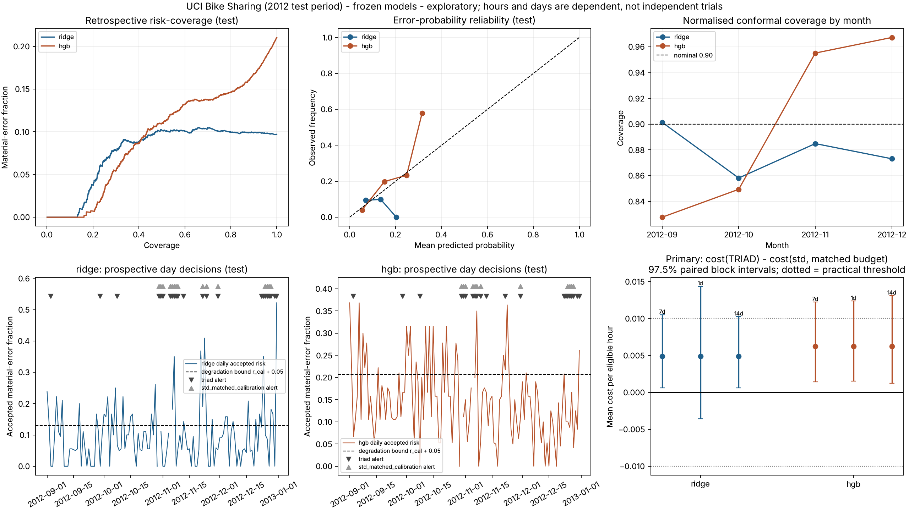

# TRIAD

**When should a system refuse to answer?**

*An open Rust research instrument for selective prediction, refusal-policy
certification, and causal sensor diagnostics.*

[](https://github.com/topherchris420/triad/actions/workflows/ci.yml)
[](LICENSE)

A useful prediction system needs to know how often its accepted answers are wrong,
how much evidence supports its refusal policy, and when its measurements have
changed. **TRIAD makes those questions measurable.**

Built at **Vers3Dynamics**, TRIAD combines a generic prediction evaluator, statistical
certifiers, explicit evidence-assessment rules, and a capacitive-sensor research
model. Its capture-stream engine replays recordings one frame at a time, exposing
only the information available at each decision. The evaluation and certification
tools work independently of the sensor simulation.

**Research status:** certification gains are supported by a pre-registered simulation.
Additional warning and evidence rules have not established an advantage over strong
existing practice. The sensor model failed numerical readiness gates; hardware
performance remains unvalidated. Capture-stream features are an engineering
component tested on synthetic inputs, with no validated refusal rule yet.

[Quickstart](#start-with-the-evidence) ·
[Capture streams](#causal-capture-stream-diagnostics) ·
[Certification](#certify-a-refusal-policy) ·
[Findings](#the-research-arc-machine-checked) ·
[Reproduction](#reproduction-and-evidence-preservation) ·
[Evidence map](#evidence-map)

## What you can use

| Task | Interface | What you get |
|---|---|---|
| Evaluate saved predictions and labels | `metrology evaluate` | Coverage, accepted-error risk, risk–coverage curves, calibration diagnostics, and sequence/cluster bootstrap intervals |
| Certify a fixed refusal policy | `certify-abstention` | Candidate-level tests, a coverage bound, and a ready/refused decision under declared assumptions |
| Plan a calibration study | `plan-certification` | Plug-in session-count estimates for legacy and Hoeffding–Bentkus certification |
| Inspect a complete sensor recording | `inspect-capture` | Capture validation, reference means, covariance, and drift diagnostics |
| Replay what was knowable at each frame | `stream-capture` | Causal reference statistics, drift, target deviations, baseline staleness, and inspectable event plans |
| Assess a claim against supplied evidence | `metrology evidence` | One of four explicit outcomes, with scope checks and evidence provenance |
| Investigate capacitive localization | FEM and inverse-model commands | Position estimates, ambiguity diagnostics, and numerical error audits |

Each tool exposes a separate input contract. A capture stream is not automatically
a labeled prediction dataset or a certified policy. The examples below show where
to begin and what additional evidence each step requires.

## Start with the evidence

Use stable Rust with Cargo and a compatible native linker. CI runs on Linux and
Windows, with Python 3.12 for the claim checker and independent verifiers.
The commands below run from the repository root.

```sh
git clone https://github.com/topherchris420/triad.git
cd triad
git switch master
cargo run --release --locked -- metrology evaluate --input examples/predictions.json --output my-report.json
cargo run --release --locked -- metrology validate --input my-report.json
```

This fixture produces **`my-report.json` and `my-report.md`** without running
FEM. In the JSON, start with `report.overall.operational`:

| Field | Read it as |
|---|---|
| `coverage` | Fraction of test predictions accepted |
| `selective_error_risk` | Fraction of accepted predictions that were wrong |
| `accepted` / `accepted_errors` | Counts behind those rates |

A `null` risk means no predictions were accepted. It does not mean zero error.
Use a fresh output path: metrology report commands refuse to overwrite reports.

For your own model, follow [`examples/predictions.json`](examples/predictions.json)
and the [input schema](docs/metrology/input-schema.json). Supply disjoint calibration
and test records with predictions, truth, uncertainty scores, and sequence IDs.
**Smaller scores mean more confident.** The threshold is fixed on calibration
scores; realized test coverage and risk are then measured separately.

The [selective-risk quickstart](docs/metrology/selective-risk-quickstart.md) includes
a standard-library Python reference checked against Rust in CI. It is also the
shortest route to the metric without building the Rust package.

## Causal capture-stream diagnostics

**What could the system have known when this frame arrived?**

`inspect-capture` summarizes a finished recording. `stream-capture` replays that
recording in timestamp order: features at frame *k* depend only on frames 0…*k*.
Target frames use reference statistics from before the target arrived and never
update the reference baseline.

```sh
cargo run --release --locked -- inspect-capture --input examples/synthetic-capture.json
cargo run --release --locked -- stream-capture --input examples/synthetic-capture.json > my-stream.json
python scripts/verify-capture-stream.py examples/synthetic-capture.json my-stream.json
```

The JSON report uses schema `triad-capture-stream-1`. It contains the configuration,
compiled event plans, and a feature record for every frame.

| Feature | What it exposes |
|---|---|
| `reference_mean`, `reference_stddev` | Rolling empty-reference baseline and sample variation |
| `drift_from_initial`, `drift_score` | Movement from the initial baseline, including a normalized drift score |
| `target_z`, `max_abs_target_z` | Target deviation relative to the available reference variation |
| `ms_since_reference` | Age of the most recent empty-reference measurement |
| `reference_frames_seen`, `reference_frames_in_window` | How much reference evidence is available |

Defaults are `--window 32` and `--initial-reference-frames 3`.
Unavailable statistics are `null`; the [feature definitions](docs/capture-stream.md#features)
explain zero-variance and rounding behavior.

The implementation uses [flexplan](crates/flexplan/VENDORED.md), Vers3Dynamics'
vendored, dependency-free event-driven feature engine. Declared dependencies
determine the execution plan for each event kind. It is a clean-room implementation
inspired by Jane Street's public Flex Model article; no Jane Street code is included.

[Rust tests](tests/capture_stream.rs) check future-frame independence, deterministic
replay, and exact agreement of final reference means and standard deviations with
the batch audit when the window contains every reference. The
[Python verifier](scripts/verify-capture-stream.py) separately recomputes the feature values.

**Boundary:** the committed capture is synthetic. These features describe variation;
they do not establish calibrated measurement uncertainty, physical positions, or
selective-risk control. Using a drift score for certification additionally requires
independent sessions and independently verified bad-event labels. The command
does not invent those labels or connect to a live acquisition device.

[Capture format and units](docs/portable-adoption.md#b-physical-capture-interchange-and-noise-inspection) ·
[Full stream contract](docs/capture-stream.md) ·
[Implementation](src/capture_stream.rs)

## Certify a refusal policy

Certification asks whether a predeclared threshold can satisfy **both** an
accepted-error limit and a minimum coverage, at a declared family-wise error budget.

```sh
cargo run --release --locked -- certify-abstention --input examples/abstention-calibration-demo.json
cargo run --release --locked -- plan-certification --coverage 0.6 --risk 0.026 --alpha 0.05 --min-coverage 0.5 --delta 0.05 --candidates 20
```

**Expected demo result: `refused`, with a `null` threshold.** The synthetic fixture
does not contain enough independent sequences to certify its targets. Successful
command execution is not the same as successful certification.

| Method | Role |
|---|---|
| `calibrate-abstention` | Conservative legacy controller using separate Hoeffding bounds |
| `certify-abstention` | Default Hoeffding–Bentkus method; provably qualifies every candidate the legacy controller qualifies |
| `certify-abstention --method betting` | Variance-adaptive alternative; no dominance guarantee over the legacy controller |

Choose the method and candidate thresholds before examining calibration data.
The statistical unit is an independent, identically distributed **sequence**;
frames within a sequence may be dependent. Labels must be reliable and scores
must not use those labels. The guarantee concerns population risk and coverage
under these assumptions, not confidence in an individual prediction.

The planner gives plug-in estimates for anticipated coverage and risk, **not a
power calculation**. See the [method, assumptions, and proof](docs/certification.md)
and the [input contract](docs/portable-adoption.md#a-conservative-abstention-on-independent-sequences).
The [Milestone 9 study](#milestone-9-certifying-refusal-with-far-less-data) measures
the data requirements under a frozen simulation protocol.

## The measurement at the center

Coverage asks **how often the system answers**. Selective risk asks **how often
those accepted answers are wrong**. Report them together.

Let the acceptance rule be $g_\tau(x)=\mathbf{1}\{s(x)\leq\tau\}$ and let
$\ell(f(x),y)$ be a declared loss bounded in $[0,1]$:

$$
C(\tau)=\mathbb{E}[g_\tau(X)],\qquad
R(\tau)=\frac{\mathbb{E}[\ell(f(X),Y)\,g_\tau(X)]}{C(\tau)}.
$$

Risk is undefined when coverage is zero. TRIAD uses an error-event loss:
misclassification for classification, or exceeding a declared error tolerance for
regression. Threshold ties are accepted. A lower risk obtained by answering fewer
questions requires a coverage comparison or an explicit cost for abstaining.

**Two evaluations serve different purposes.** A calibration-fixed threshold can
be applied to future inputs, but its test coverage can differ from the target.
Retrospective ranking compares methods at matched test coverage, but does not
supply a deployable threshold. See the [method definition](docs/metrology/method-definition.md)
for score conventions, tie handling, AURC, and bootstrap assumptions.

Selective risk is an **established metric**, credited to the
selective-classification literature. TRIAD provides an implementation and tests
additional ideas around it; it does not claim to have invented the metric.

## How evidence decisions work

An evidence assessment pairs a typed claim and its scope with a record of what was
computed, supplied, or attested.

```sh
cargo run --release --locked -- metrology evidence --input examples/evidence-assessment.json --output my-evidence.json
cargo run --release --locked -- metrology validate --input my-evidence.json
```

Explicit rules return `supported_within_scope`, `insufficient_evidence`,
`contradicted`, or `not_applicable`. Unknown evidence never passes a rule.
Attestations are reported but not relied upon; a matching hash establishes byte
consistency only.

These outcomes describe what the supplied evidence supports under the rules.
They are not confidence percentages or guarantees of truth. The Milestone 8
failures show that provenance cannot turn a historical measurement into a forecast.

[Rule definitions and limits](docs/metrology/evidence-sufficiency-method.md) ·
[Rust implementation](src/evidence.rs) ·
[Example assessment](examples/evidence-assessment.json)

## The research arc, machine-checked

The question widened from *Can this position be trusted?* to *Does this evidence
support the claim being made?* The table below keeps the answers attached to their
archived sources, including failed gates and negative comparisons.

<!-- claims-ledger:start (rendered from docs/claims-ledger.json by scripts/check-claims.py --write; edit the ledger, not this table) -->
| Milestone | Question | What the archived evidence says | Status | Source |
|:--:|---|---|---|---|
| 2 | Does an optimizer's convergence flag tell you the answer is trustworthy? | **No.** 451 nonconvergence flags among 1,080 positions, yet only 10 of the 20 errors above 5 mm were flagged | Descriptive, synthetic pilot | [evaluation.json](results/evaluation.json) |
| 3 | Does a physics-informed rejection score (D) beat posterior expected-error rejection (C2)? | **No.** At matched 80% acceptance D accepted 37 errors above 5 mm versus 42 for C2, a risk reduction of 0.174 percentage points against a 2-point threshold. Worst surrogate discrepancy 37.78 noise units | Hypothesis not supported; numerical gate failed | [summary.json](results/selective-v3/summary.json) |
| 4 | Is the simulated sensor accurate to within its own noise? | **No.** Local interpolation cut interpolation discrepancy from 29.86 to 2.28 noise units, but mesh discrepancy stays at 9.82 and total mismatch at 10.48 | Numerical readiness false | [numerical-components-v4.json](results/numerical-components-v4.json) |
| 6 | Do validity warnings add value on real data (OpenML Electricity)? | **No.** Accuracy 65.57% (logistic) and 66.00% (forest). Gating cut logistic coverage to 55.55% while accepted error risk moved only from 31.19% to 30.39% | Negative | [report.json](results/benchmark-electricity/report.json) |
| 7 | Do evidence-qualified trust decisions beat standard monitoring (UCI Bike Sharing)? | **No.** TRIAD minus standard monitoring: Δ cost +0.0049 (ridge) and +0.0062 (gradient boosting) per hour | Negative; replicates Milestone 6 | [report.json](results/bike-sharing-v7/report.json) |
| 7 | Do explicit claim-relative rules catch unsupported claims that standard checks miss? | 43/47 versus 20/47 with 0 false rejections, **on an author-constructed suite** | Engineering capability only | [report.json](results/evidence-suite-v7/report.json) |
| 8 | Do those rules beat reviewers written without seeing TRIAD, judged by real outcomes? | **No.** Decision cost 0.159 versus 0.121 (blind statistical reviewer, Δ +0.038, inferior) and 0.160 (blind checklist). Never endorsing costs 0.125. 5,078 claims, five datasets | Not established (pre-registered) | [report.json](results/evidence-outcomes-v8/score/report.json) |
| 8 | Does the Milestone 7 advantage over standard checks survive world truth? | **Yes.** Δ −0.172 versus standard checks and −0.050 versus checks with scope, but blind reviewers reproduce it | Replicated, not distinctive | [report.json](results/evidence-outcomes-v8/score/report.json) |
| 8 | Where do the rules fail? | Next-week operational claims: 7 of 19 false ones endorsed, because the rules do not forecast | Repair needs a new frozen test | [report.json](results/evidence-outcomes-v8/score/report.json) |
| 9 | Can established risk-control tests certify the same refusal guarantee with fewer independent sessions? | **Yes.** 80% certification at 2,500 sessions (Hoeffding–Bentkus) and 1,000 (betting) versus 25,000 (legacy). 0 dominance violations; no false certification above δ | Supported; pre-registered simulation, not real data | [report.json](results/certify-v1/report.json) |
| 9 | Does treating dependent frames as independent cause false certification? | **Not shown.** The naive frame-level test stayed below δ under moderate clustering, and certified 98% of graded studies at 250 sessions | Exploratory expectation not confirmed | [report.json](results/certify-v1/report.json) |
<!-- claims-ledger:end -->

The [claims ledger](docs/claims-ledger.json) binds the table and quoted headline
results below to their source fields. `python scripts/check-claims.py` recomputes
them and fails CI on transcription drift. It checks faithful reporting;
it does not establish scientific validity.

## Milestone 9: certifying refusal with far less data

October 15, 2026 · **Supported** (pre-registered simulation; statistical engineering,
not a sensor or real-data result).

In the graded, clustered simulation, the targets were accepted-error risk at most
5%, coverage at least 50%, and δ = 0.05. TRIAD's legacy controller needed **25,000 independent sessions**
to succeed in 80% of simulated studies. With the same guarantee and error budget,
a linearised Hoeffding–Bentkus test needed **2,500**, and a betting test **1,000**.

These are results from the study's tested sample-size grid, not universal data
requirements. No valid method's observed false-certification rate exceeded δ
in any simulated condition.

| Pre-registered result | Archived finding |
|---|---|
| Validity | No legacy, Hoeffding–Bentkus or betting false-certification rate exceeded δ (null and graded truth, independent and clustered frames) |
| Dominance, proved and tested | Hoeffding–Bentkus qualifies every threshold legacy qualifies: **0 dominance violations** across every simulated study |
| Better operating point from the same data | At 25,000 clustered sessions, the mean true coverage of the selected threshold is **0.65** for legacy, **0.75** for Hoeffding–Bentkus and **0.77** for betting |
| An expectation that failed | The naive test that treats dependent frames as independent did **not** over-certify here. It certified **98%** of graded studies with only **250** sessions, so this design shows its assumption is false but not that the error matters |

The three ideas are established and credited: linearising selective risk, the
Hoeffding–Bentkus bound of risk-controlling prediction sets and Learn then Test,
and Waudby-Smith–Ramdas betting. TRIAD contributes an implementation behind its
fail-closed decision API, a short dominance proof, a planner, and an archived
study. The protocol was committed before any simulation code. The implementation
and an independent standard-library verifier were committed before the single run.

```sh
cargo run --release --locked -- certify-study --validate results/certify-v1/report.json
python scripts/verify-certify.py --study results/certify-v1/report.json
```

[Method and proof](docs/certification.md) ·
[Frozen protocol](experiments/certify-v1.json) ·
[Results](results/certify-v1/report.md) ·
[Independent verifier](scripts/verify-certify.py)

<details>
<summary>Read Milestone 8: outcome-grounded claims and blinded comparators</summary>

## Milestone 8: independent, outcome-grounded test

October 11, 2026 · **Not established** (pre-registered verdict).

The test covered 5,078 claims on five public datasets new to TRIAD: Beijing air
quality, I-94 traffic, household power, gas-sensor drift, and bank marketing.
The protocol, generator, and comparators were frozen before cases were generated.
Truth came from held-out outcomes rather than an author-labeled claim suite.

| Comparison or failure | Archived finding |
|---|---|
| Blind statistical reviewer | Decision cost 0.159 versus 0.121 for a blind statistical reviewer (Δ = +0.038 [+0.008, +0.070], inferior) |
| Blind checklist reviewer | TRIAD's cost was 0.159 versus 0.160 for a blind REFORMS-style checklist (Δ = −0.001, indistinguishable) |
| Never endorse a claim | Never endorsing anything costs 0.125 |
| Simpler checks | Δ = −0.172 versus standard checks and −0.050 versus checks with scope; stronger blind reviewers reproduced the advantage |
| Future operational claims | For next-week claims, it endorsed 7 of 19 false ones; the rules do not forecast |

Lower decision cost is better under the frozen protocol's loss definition.
TRIAD beat simpler checks but did not establish a distinctive advantage over strong
reviewers. An independent verification implementation passed 109,685 checks;
regeneration from the archives was byte-identical.

Here, **independent means separately written code and blinded comparator design**.
The comparator author was an AI agent of the same model family working from a
brief alone. No unrelated human research team has replicated or adjudicated the study.

[Results and full reproduction](docs/metrology/milestone8-results.md) ·
[Frozen protocol](benchmarks/evidence-outcomes/protocol.json) ·
[Blind comparators](benchmarks/evidence-outcomes/comparators/README.md)

</details>

<details>
<summary>Read the real-data studies: Bike Sharing and Electricity</summary>

## Real-data studies: additional gates did not improve decisions

**Milestone 7 — UCI Bike Sharing.** Evidence-qualified day decisions cost more than
standard monitoring for both ridge and gradient boosting
(Δ = +0.0049 and +0.0062 per hour). No day-level gate beat plain selective prediction
at the primary abstention cost; benefits appeared only when abstaining was cheap.

The earlier author-constructed claim suite showed
43/47 versus 20/47, with no false rejections, for TRIAD versus standard checks.
That was an engineering result. Milestone 8 tested the apparent advantage against
real outcomes and stronger blinded reviewers.



[Milestone 7 results](docs/metrology/milestone7-results.md) ·
[Manuscript](docs/metrology/milestone7-manuscript.md) / [PDF](docs/metrology/milestone7-manuscript.pdf) ·
[Reproduction](docs/metrology/milestone7-reproduction.md) ·
[Research audit](docs/metrology/milestone7-research-audit.md)

**Milestone 6 — OpenML Electricity.** Combined warnings caught the same degraded
windows as a simpler covariate warning and produced more false alarms. Gating
reduced coverage without establishing a reduction in accepted error risk.

| Model | Accuracy | Selective coverage | Accepted error risk | Gated coverage / risk |
|---|---:|---:|---:|---:|
| Logistic regression | 65.57% | 77.34% | 31.19% | 55.55% / 30.39% |
| Random forest | 66.00% | 60.46% | 25.84% | 26.50% / 28.16% |

[Milestone 6 results](docs/metrology/milestone6-real-world-results.md) ·
[Dataset and reproduction](benchmarks/electricity/README.md)

These are evaluations on public real data with independent computational checks.
Temporal dependence, limited settings, conventional decision costs, and data
provenance limitations restrict generalization. Neither study establishes better
prediction from TRIAD's added validity or evidence layers.

</details>

## Origins: the capacitive sensor

Four electrodes produce ten unique self/mutual capacitance channels. TRIAD asks
whether position, unknown dielectric properties, and environmental drift can be
distinguished well enough to justify returning a location.

<p align="center">
  
</p>

*Conceptual engineering illustration. The model is 2D; this is neither a 3D
simulation nor a computed electric-field visualization.*

The forward model solves an idealized electrostatic cross-section:

$$
\nabla\cdot\left(\varepsilon(\mathbf{r})\,\nabla\phi(\mathbf{r})\right)=0.
$$

P1 finite elements generate a Maxwell capacitance matrix. A same-mesh empty
reference is subtracted; drift, correlated noise, and unknown material properties
enter the observation model. A bounded inverse estimator fits position and
relative permittivity. [Fenris](https://crates.io/crates/fenris),
[Spade](https://crates.io/crates/spade), and [faer](https://crates.io/crates/faer)
supply finite-element assembly, meshing, and sparse linear algebra.

The cross-section reports capacitance **per unit length in pF/m**. Physical 3D
recordings use **pF** and cannot be inserted directly into that likelihood. There
are no fabricated sensors or hardware trials in this study.

<details>
<summary>Read the sensor findings: convergence failures and the unresolved numerical error budget</summary>

### What the sensor experiments established

**Milestone 2 — convergence and correctness diverged.** The frozen pilot contains
**451 nonconvergence flags among 1,080 returned positions**.
Only **10 of the 20 errors above 5 mm** are flagged; the others have successful
convergence flags. This is a descriptive synthetic finding, not a validated
confidence rule. `cargo run --locked -- audit` derives the optimizer audit from
saved predictions without rerunning FEM.

**Milestone 3 — Scientific hypothesis not supported.** At matched 80% acceptance,
the physics-informed selector D accepted **37** errors above 5 mm
versus **42** for posterior C2, a **0.174-percentage-point** exploratory risk reduction.
It fell short of the preregistered **2-percentage-point** practical threshold.
The numerical audit also failed, with worst surrogate discrepancy of
**37.78 covariance-whitened noise units**. The development-selected electrode layout
underperformed the original on its independent holdout screening metric.

**Milestone 4 — interpolation improved; mesh error remained.** A development-only
local stencil reduced **the maximum interpolation-only discrepancy from 29.86 to 2.28 covariance-whitened noise units**.
Direct mesh discrepancy still reached **9.82 noise units**, and
candidate total-model mismatch reached **10.48**. Numerical readiness remains false;
the candidate is not integrated into inference.

The original solver passed its prescribed analytical, reciprocity, conservation,
and relative-refinement checks. Those checks did not establish that model error
was small relative to measurement noise. The later failed gates address that
stricter requirement.

[Physical model](docs/physical-model.md) ·
[Pilot results](docs/research-status.md) ·
[Milestone 3 results](docs/milestone3-results-2026-10-11.md) ·
[Milestone 4 diagnosis](docs/milestone4-development-results-2026-10-11.md) ·
[Hardware and 3D roadmap](docs/portable-adoption.md#next-physical-experiment-not-implemented)

</details>

## Reproduction and evidence preservation

Check the documentation's claims and the software contracts:

```sh
python scripts/check-claims.py
cargo fmt --all -- --check
cargo test --locked
```

For a lightweight real-data replay, use the committed Electricity benchmark inputs
and a fresh output directory:

```sh
cargo run --release --locked -- metrology benchmark --input benchmarks/electricity/manifest.json --output results/my-electricity
cargo run --release --locked -- metrology validate --input results/my-electricity/report.json
```

To reproduce the Bike Sharing and outcome-grounded claim studies, follow their
full packages; these include the Python dependencies, comparators, scoring, and
independent verifiers:

| Study | Reproduction instructions |
|---|---|
| Generic metric and trained demo | [Metrology reproduction](docs/metrology/reproducibility.md) |
| Electricity | [Benchmark package](benchmarks/electricity/README.md) |
| Bike Sharing and author-constructed claim suite | [Milestone 7 package](docs/metrology/milestone7-reproduction.md) |
| Outcome-grounded evidence sufficiency | [Milestone 8 package](docs/metrology/milestone8-results.md#7-verification-and-reproduction) |
| Certification of refusal policies (simulation) | [Milestone 9 verification](docs/certification.md#verification) |
| Original FEM and selective study | [Original protocol](docs/experiment-protocol.md), [selective protocol](docs/selective-v3.md), [integrity rules](docs/research-integrity.md) |

Frozen sensor and study artifacts are protected by hashes. Versioned research
commands refuse to replace their archived outputs, including incomplete runs.
The original `validate`, `baseline`, and `all` commands can replace baseline
outputs: preserve the archive and follow the reproduction instructions in an
isolated checkout before running them. Replaying exposed seeds demonstrates
computational reproduction; a scientific revision needs a new frozen protocol and
fresh independent test data.

CI checks Rust formatting, locked tests, the claims ledger, the Python metric
reference, benchmark replay, certification cross-checks, causal capture replay,
and independent verifiers on Linux and Windows.
It does not rerun the full expensive FEM baseline on every commit. Passing CI
establishes the checked software behavior, not a scientific hypothesis.

## NIST submission

The **established selective-risk metric** was submitted through the NIST AI
Metrology Center's community process as
[usnistgov/ai-metrology-submissions#24](https://github.com/usnistgov/ai-metrology-submissions/pull/24).
TRIAD is listed as one implementation resource. The submission is not NIST
validation or endorsement of TRIAD; the linked pull request is the authoritative
record of its review status.

TRIAD's experimental evidence-sufficiency method is excluded from the proposal.
The [submission package](docs/metrology/nist-submission/README.md) records official
validator checks, scientific references, scope, and the submission gate. The
[earlier prototype draft](docs/metrology/nist-submission-draft.yml) remains a
historical artifact, superseded by that package.

## Where the research goes next

The next useful advance must change a measured outcome:

1. **Validate a refusal policy on real sessions.** Freeze the score, candidate
   thresholds, bad-event definition, and protocol before testing. Evaluate the capture-stream diagnostics
   against strong alternatives on held-out sessions and devices.
2. **Repair evidence rules, then test on untouched cases.** Target future operational
   claims and dependent outcomes with blinded comparators.
3. **Close the sensor's numerical error budget.** Separate mesh, interpolation,
   and optimizer errors, then run a powered C2-versus-D comparison on fresh data.
4. **Establish a physical model.** Collect repeatable captures, validate finite 3D
   fields and real noise, and compare position estimates with measured ground truth.

These are research directions. See the [certification limits](docs/certification.md#limits),
[Milestone 8 discussion](docs/metrology/milestone8-results.md),
[numerical repair plan](docs/milestone4-plan.md), and
[physical validation roadmap](docs/portable-adoption.md#next-physical-experiment-not-implemented).

## Evidence map

| What you want to inspect | Source |
|---|---|
| Headline claims and their archived fields | [Claims ledger](docs/claims-ledger.json), [claim checker](scripts/check-claims.py) |
| Metric definition and independent Python reference | [Quickstart](docs/metrology/selective-risk-quickstart.md), [method definition](docs/metrology/method-definition.md) |
| Certifying a refusal policy, and how much data it costs | [Certification method](docs/certification.md), [Milestone 9 report](results/certify-v1/report.json) |
| Causal capture features and event-engine provenance | [Stream contract](docs/capture-stream.md), [tests](tests/capture_stream.rs), [flexplan provenance](crates/flexplan/VENDORED.md) |
| Strongest evidence-rule test | [Milestone 8 results](docs/metrology/milestone8-results.md), [machine-readable report](results/evidence-outcomes-v8/score/report.json) |
| Real-data decision costs and limitations | [Bike Sharing results](docs/metrology/milestone7-results.md), [Electricity results](docs/metrology/milestone6-real-world-results.md) |
| Sensor assumptions, inference, and numerical checks | [Physical model](docs/physical-model.md), [forward source](src/forward.rs), [inverse source](src/inverse.rs), [validation](results/validation.json) |
| Original protocol, amendments, and replay | [Protocol](docs/experiment-protocol.md), [amendments](docs/protocol-amendments.md), [replay record](results/reproducibility-check.json) |
| Prior art and claim boundaries | [Literature review](docs/metrology/milestone7-literature-review.md), [sensor limitations](docs/limitations.md) |

## Authorship and reuse

Independent research by **Christopher Woodyard · Vers3Dynamics**. Released under
the [MIT License](LICENSE). Contributions should preserve archived findings,
record provenance, and test new scientific claims against fresh evidence.
See [contribution standards](CONTRIBUTING.md).

---

**Vers3Dynamics**  
*Resonance as Substrate. Intelligence as a Layer.*

**TRIAD begins by asking what the measurements permit us to know.**
