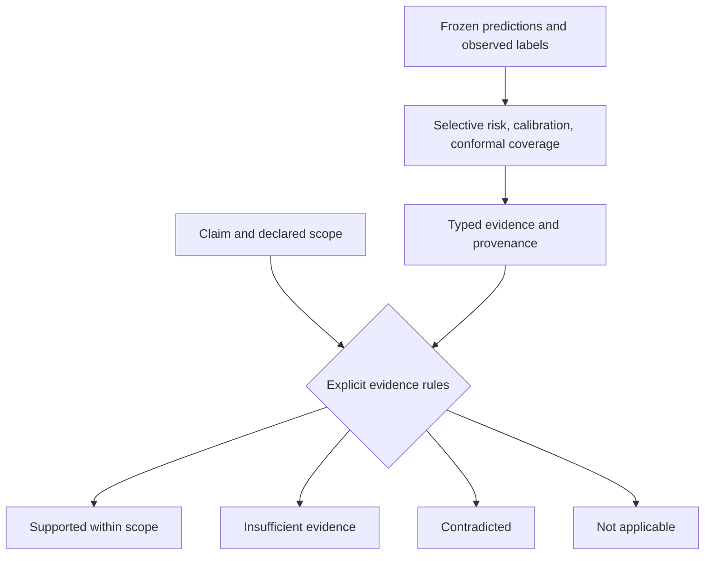
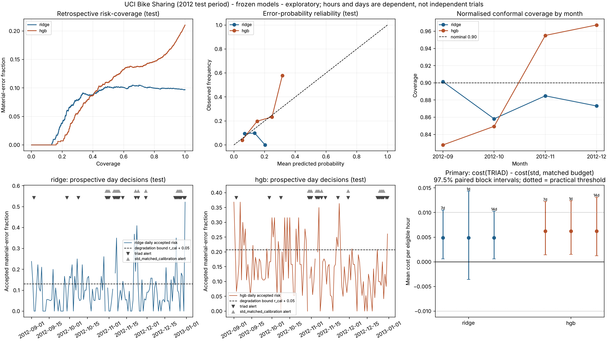

# TRIAD

**When should a sensor refuse to answer?**

*An open Rust research instrument for selective prediction, evidence sufficiency,
and the limits of confident inference.*

[](https://github.com/topherchris420/triad/actions/workflows/ci.yml)
[](LICENSE)

A system can converge on an answer and still be wrong. It can report uncertainty
and still underestimate its errors. It can carry an evidence record and still make
a claim that the record does not support.

TRIAD makes those gaps inspectable. Built by **Christopher Woodyard at
Vers3Dynamics**, it evaluates errors among accepted predictions, tests explicit
rules for assessing reliability claims, and traces its findings back to frozen
protocols and machine-readable results. The work began with a simulated capacitive
sensor and expanded into experiments on real prediction data.

**Research status:** TRIAD's added warning and evidence rules have not established
an advantage over strong existing practice. Its sensor studies failed numerical
readiness gates. The repository provides runnable measurement tools and archived
negative findings; predictive superiority and hardware confidence remain unvalidated.

[Quickstart](#start-with-the-evidence) ·
[What you can use](#what-you-can-use) ·
[Findings](#the-research-arc-machine-checked) ·
[Latest study](#milestone-8-independent-outcome-grounded-test) ·
[Sensor origins](#origins-the-capacitive-sensor) ·
[Evidence map](#evidence-map)

## What you can use

| Your question | TRIAD provides | Start here |
|---|---|---|
| How often are the answers I accept wrong? | Classification and regression evaluation, risk–coverage curves, calibration diagnostics, and sequence/cluster bootstrap intervals | [Selective-risk quickstart](docs/metrology/selective-risk-quickstart.md) |
| Does this evidence support this particular claim? | Typed claims, explicit scope checks, evidence provenance, and four inspectable decision outcomes | [Evidence-sufficiency method](docs/metrology/evidence-sufficiency-method.md) |
| Do extra warnings improve decisions on real streams? | Frozen Electricity and Bike Sharing benchmarks, simpler comparators, and independent verification code | [Real-data reproduction](docs/metrology/milestone7-reproduction.md) |
| Can a fixed abstention policy meet declared risk and coverage bounds? | A conservative controller calibrated on independent labeled sequences; it refuses certification when evidence is insufficient | [Portable components](docs/portable-adoption.md) |
| Are my sensor recordings structurally usable? | Ten-channel capture validation, unit checks, covariance and reference-drift diagnostics | [Capture contract](docs/portable-adoption.md#b-physical-capture-interchange-and-noise-inspection) |
| Why can a position estimator appear certain and still fail? | A 2D electrostatic model, inverse estimator, ambiguity diagnostics, and numerical error audits | [Physical model](docs/physical-model.md) |

The generic evaluator works with saved predictions and labels; it does not require
the FEM sensor simulation. Selective risk is an **established metric**, credited to
the selective-classification literature. TRIAD supplies one implementation and
tests additional ideas around it.

## Start with the evidence

Use a Rust toolchain with Cargo and a compatible native linker. The locked test
suite runs in Linux and Windows CI. Python is needed for claim checking and the
independent study verifiers; each real-data study lists its own dependencies.

```sh
git clone https://github.com/topherchris420/triad.git
cd triad
git switch master
cargo run --release --locked -- metrology evaluate --input examples/predictions.json --output my-report.json
cargo run --release --locked -- metrology validate --input my-report.json
```

This small fixture produces **`my-report.json` and `my-report.md`** without running
FEM. The JSON separates calibration-fixed evaluation from retrospective
matched-coverage analysis. Read `report.overall.operational` for realized coverage,
selective error risk, accepted count, and accepted-error count. A `null` risk means
no accepted predictions, not zero errors. Use a new output path for each run;
the metrology commands refuse to overwrite reports.

To evaluate your own model, follow the
[`triad-metrology-1` example](examples/predictions.json). Supply disjoint calibration
and test records with predictions, truth, uncertainty scores, and sequence IDs.
**Smaller scores mean more confident.** Fix the threshold using calibration scores,
then measure the realized coverage and risk on the test split. Target coverage is
not a guarantee of future coverage or error control.

The [quickstart](docs/metrology/selective-risk-quickstart.md) also includes a
standard-library Python reference, checked against Rust in CI, for calculating
the metric without building TRIAD.

Explore the other interfaces and check the archived claims:

```sh
cargo run --locked -- metrology --help
cargo run --locked -- metrology evidence --input examples/evidence-assessment.json --output my-evidence.json
cargo run --locked -- calibrate-abstention --input examples/abstention-calibration-demo.json
cargo run --locked -- inspect-capture --input examples/synthetic-capture.json
python scripts/check-claims.py
cargo test --locked
```

The abstention and capture examples are **synthetic fixtures**. The abstention
example intentionally refuses certification because its calibration sample is
insufficient. The capture inspector checks recordings; it does not infer physical
positions or validate hardware performance.

## The measurement at the center

Coverage asks **how often the system answers**. Selective risk asks **how often
those accepted answers are wrong**. Report them together.

Let the acceptance rule be $g_\tau(x)=\mathbf{1}\{s(x)\leq\tau\}$ and let
$\ell(f(x),y)$ be a declared loss bounded in $[0,1]$:

$$
C(\tau)=\mathbb{E}[g_\tau(X)],\qquad
R(\tau)=\frac{\mathbb{E}[\ell(f(X),Y)\,g_\tau(X)]}{C(\tau)}.
$$

Risk is undefined when coverage is zero. TRIAD uses an error-event loss:
misclassification for classification, or exceeding a declared error tolerance for
regression. Threshold ties are accepted. A lower risk obtained by answering fewer
questions requires a coverage comparison or an explicit cost for abstaining.

**Two evaluations serve different purposes.** A calibration-fixed threshold can
be applied to future inputs, but its test coverage can differ from the target.
Retrospective ranking compares methods at matched test coverage, but does not
supply a deployable threshold. See the [method definition](docs/metrology/method-definition.md)
for score conventions, tie handling, AURC, and bootstrap assumptions.

## The research arc, machine-checked

The question widened from *Can this position be trusted?* to *Does this evidence
support the claim being made?* The table below keeps the answers attached to their
archived sources, including failed gates and negative comparisons.

<!-- claims-ledger:start (rendered from docs/claims-ledger.json by scripts/check-claims.py --write; edit the ledger, not this table) -->
| Milestone | Question | What the archived evidence says | Status | Source |
|:--:|---|---|---|---|
| 2 | Does an optimizer's convergence flag tell you the answer is trustworthy? | **No.** 451 nonconvergence flags among 1,080 positions, yet only 10 of the 20 errors above 5 mm were flagged | Descriptive, synthetic pilot | [evaluation.json](results/evaluation.json) |
| 3 | Does a physics-informed rejection score (D) beat posterior expected-error rejection (C2)? | **No.** At matched 80% acceptance D accepted 37 errors above 5 mm versus 42 for C2, a risk reduction of 0.174 percentage points against a 2-point threshold. Worst surrogate discrepancy 37.78 noise units | Hypothesis not supported; numerical gate failed | [summary.json](results/selective-v3/summary.json) |
| 4 | Is the simulated sensor accurate to within its own noise? | **No.** Local interpolation cut interpolation discrepancy from 29.86 to 2.28 noise units, but mesh discrepancy stays at 9.82 and total mismatch at 10.48 | Numerical readiness false | [numerical-components-v4.json](results/numerical-components-v4.json) |
| 6 | Do validity warnings add value on real data (OpenML Electricity)? | **No.** Accuracy 65.57% (logistic) and 66.00% (forest). Gating cut logistic coverage to 55.55% while accepted error risk moved only from 31.19% to 30.39% | Negative | [report.json](results/benchmark-electricity/report.json) |
| 7 | Do evidence-qualified trust decisions beat standard monitoring (UCI Bike Sharing)? | **No.** TRIAD minus standard monitoring: Δ cost +0.0049 (ridge) and +0.0062 (gradient boosting) per hour | Negative; replicates Milestone 6 | [report.json](results/bike-sharing-v7/report.json) |
| 7 | Do explicit claim-relative rules catch unsupported claims that standard checks miss? | 43/47 versus 20/47 with 0 false rejections, **on an author-constructed suite** | Engineering capability only | [report.json](results/evidence-suite-v7/report.json) |
| 8 | Do those rules beat reviewers written without seeing TRIAD, judged by real outcomes? | **No.** Decision cost 0.159 versus 0.121 (blind statistical reviewer, Δ +0.038, inferior) and 0.160 (blind checklist). Never endorsing costs 0.125. 5,078 claims, five datasets | Not established (pre-registered) | [report.json](results/evidence-outcomes-v8/score/report.json) |
| 8 | Does the Milestone 7 advantage over standard checks survive world truth? | **Yes.** Δ −0.172 versus standard checks and −0.050 versus checks with scope, but blind reviewers reproduce it | Replicated, not distinctive | [report.json](results/evidence-outcomes-v8/score/report.json) |
| 8 | Where do the rules fail? | Next-week operational claims: 7 of 19 false ones endorsed, because the rules do not forecast | Repair needs a new frozen test | [report.json](results/evidence-outcomes-v8/score/report.json) |
<!-- claims-ledger:end -->

The [claims ledger](docs/claims-ledger.json) binds the table and quoted headline
results below to their source fields. `python scripts/check-claims.py` recomputes
them and fails CI on transcription drift. It checks faithful reporting;
it does not establish scientific validity.

## Milestone 8: independent, outcome-grounded test

October 11, 2026 · **Not established** (pre-registered verdict).

The test covered 5,078 claims on five public datasets new to TRIAD: Beijing air
quality, I-94 traffic, household power, gas-sensor drift, and bank marketing.
The protocol, generator, and comparators were frozen before cases were generated.
Truth came from held-out outcomes rather than an author-labeled claim suite.

| Comparison or failure | Archived finding |
|---|---|
| Blind statistical reviewer | Decision cost 0.159 versus 0.121 for a blind statistical reviewer (Δ = +0.038 [+0.008, +0.070], inferior) |
| Blind checklist reviewer | TRIAD's cost was 0.159 versus 0.160 for a blind REFORMS-style checklist (Δ = −0.001, indistinguishable) |
| Never endorse a claim | Never endorsing anything costs 0.125 |
| Simpler checks | Δ = −0.172 versus standard checks and −0.050 versus checks with scope; stronger blind reviewers reproduced the advantage |
| Future operational claims | For next-week claims, it endorsed 7 of 19 false ones; the rules do not forecast |

Lower decision cost is better under the frozen protocol's loss definition.
TRIAD beat simpler checks but did not establish a distinctive advantage over strong
reviewers. An independent verification implementation passed 109,685 checks;
regeneration from the archives was byte-identical.

Here, **independent means separately written code and blinded comparator design**.
The comparator author was an AI agent of the same model family working from a
brief alone. No unrelated human research team has replicated or adjudicated the study.

[Results and full reproduction](docs/metrology/milestone8-results.md) ·
[Frozen protocol](benchmarks/evidence-outcomes/protocol.json) ·
[Blind comparators](benchmarks/evidence-outcomes/comparators/README.md)

## How evidence decisions work

An evidence assessment pairs a typed claim and its scope with a record of what was
computed, supplied, or attested. Explicit rules return `supported_within_scope`,
`insufficient_evidence`, `contradicted`, or `not_applicable`.



Unknown evidence never passes a rule. Attestations are reported but never relied
upon; a matching hash establishes byte consistency only. These are rule outputs,
not confidence percentages or guarantees of truth. The Milestone 8 failures show
why that distinction matters: explicit provenance cannot verify supplied evidence
against the world or turn a historical measurement into a forecast.

[Rule definitions and limits](docs/metrology/evidence-sufficiency-method.md) ·
[Rust implementation](src/evidence.rs) ·
[Example assessment](examples/evidence-assessment.json)

## Real-data studies: additional gates did not improve decisions

**Milestone 7 — UCI Bike Sharing.** Evidence-qualified day decisions cost more than
standard monitoring for both ridge and gradient boosting
(Δ = +0.0049 and +0.0062 per hour). No day-level gate beat plain selective prediction
at the primary abstention cost; benefits appeared only when abstaining was cheap.

The earlier author-constructed claim suite showed
43/47 versus 20/47, with no false rejections, for TRIAD versus standard checks.
That was an engineering result. Milestone 8 tested the apparent advantage against
real outcomes and stronger blinded reviewers.



[Milestone 7 results](docs/metrology/milestone7-results.md) ·
[Manuscript](docs/metrology/milestone7-manuscript.md) / [PDF](docs/metrology/milestone7-manuscript.pdf) ·
[Reproduction](docs/metrology/milestone7-reproduction.md) ·
[Research audit](docs/metrology/milestone7-research-audit.md)

**Milestone 6 — OpenML Electricity.** Combined warnings caught the same degraded
windows as a simpler covariate warning and produced more false alarms. Gating
reduced coverage without establishing a reduction in accepted error risk.

| Model | Accuracy | Selective coverage | Accepted error risk | Gated coverage / risk |
|---|---:|---:|---:|---:|
| Logistic regression | 65.57% | 77.34% | 31.19% | 55.55% / 30.39% |
| Random forest | 66.00% | 60.46% | 25.84% | 26.50% / 28.16% |

[Milestone 6 results](docs/metrology/milestone6-real-world-results.md) ·
[Dataset and reproduction](benchmarks/electricity/README.md)

These are evaluations on public real data with independent computational checks.
Temporal dependence, limited settings, conventional decision costs, and data
provenance limitations restrict generalization. Neither study establishes better
prediction from TRIAD's added validity or evidence layers.

## Origins: the capacitive sensor

Four electrodes produce ten unique self/mutual capacitance channels. TRIAD asks
whether position, unknown dielectric properties, and environmental drift can be
distinguished well enough to justify returning a location.

<p align="center">
  
</p>

*Conceptual engineering illustration. The model is 2D; this is neither a 3D
simulation nor a computed electric-field visualization.*

The forward model solves an idealized electrostatic cross-section:

$$
\nabla\cdot\left(\varepsilon(\mathbf{r})\,\nabla\phi(\mathbf{r})\right)=0.
$$

P1 finite elements generate a Maxwell capacitance matrix. A same-mesh empty
reference is subtracted; drift, correlated noise, and unknown material properties
enter the observation model. A bounded inverse estimator fits position and
relative permittivity. [Fenris](https://crates.io/crates/fenris),
[Spade](https://crates.io/crates/spade), and [faer](https://crates.io/crates/faer)
supply finite-element assembly, meshing, and sparse linear algebra.

The cross-section reports capacitance **per unit length in pF/m**. Physical 3D
recordings use **pF** and cannot be inserted directly into that likelihood. There
are no fabricated sensors or hardware trials in this study.

### What the sensor experiments established

**Milestone 2 — convergence and correctness diverged.** The frozen pilot contains
**451 nonconvergence flags among 1,080 returned positions**.
Only **10 of the 20 errors above 5 mm** are flagged; the others have successful
convergence flags. This is a descriptive synthetic finding, not a validated
confidence rule. `cargo run --locked -- audit` derives the optimizer audit from
saved predictions without rerunning FEM.

**Milestone 3 — Scientific hypothesis not supported.** At matched 80% acceptance,
the physics-informed selector D accepted **37** errors above 5 mm
versus **42** for posterior C2, a **0.174-percentage-point** exploratory risk reduction.
It fell short of the preregistered **2-percentage-point** practical threshold.
The numerical audit also failed, with worst surrogate discrepancy of
**37.78 covariance-whitened noise units**. The development-selected electrode layout
underperformed the original on its independent holdout screening metric.

**Milestone 4 — interpolation improved; mesh error remained.** A development-only
local stencil reduced **the maximum interpolation-only discrepancy from 29.86 to 2.28 covariance-whitened noise units**.
Direct mesh discrepancy still reached **9.82 noise units**, and
candidate total-model mismatch reached **10.48**. Numerical readiness remains false;
the candidate is not integrated into inference.

The original solver passed its prescribed analytical, reciprocity, conservation,
and relative-refinement checks. Those checks did not establish that model error
was small relative to measurement noise. The later failed gates address that
stricter requirement.

[Physical model](docs/physical-model.md) ·
[Pilot results](docs/research-status.md) ·
[Milestone 3 results](docs/milestone3-results-2026-10-11.md) ·
[Milestone 4 diagnosis](docs/milestone4-development-results-2026-10-11.md) ·
[Hardware and 3D roadmap](docs/portable-adoption.md#next-physical-experiment-not-implemented)

## Reproduction and evidence preservation

For a lightweight real-data replay, use the committed Electricity benchmark inputs
and a fresh output directory:

```sh
cargo run --release --locked -- metrology benchmark --input benchmarks/electricity/manifest.json --output results/my-electricity
cargo run --release --locked -- metrology validate --input results/my-electricity/report.json
```

To reproduce the Bike Sharing and outcome-grounded claim studies, follow their
full packages; these include the Python dependencies, comparators, scoring, and
independent verifiers:

| Study | Reproduction instructions |
|---|---|
| Generic metric and trained demo | [Metrology reproduction](docs/metrology/reproducibility.md) |
| Electricity | [Benchmark package](benchmarks/electricity/README.md) |
| Bike Sharing and author-constructed claim suite | [Milestone 7 package](docs/metrology/milestone7-reproduction.md) |
| Outcome-grounded evidence sufficiency | [Milestone 8 package](docs/metrology/milestone8-results.md#7-verification-and-reproduction) |
| Original FEM and selective study | [Original protocol](docs/experiment-protocol.md), [selective protocol](docs/selective-v3.md), [integrity rules](docs/research-integrity.md) |

Frozen sensor and study artifacts are protected by hashes. Versioned research
commands refuse to replace their archived outputs, including incomplete runs.
The original `validate`, `baseline`, and `all` commands can replace baseline
outputs: preserve the archive and follow the reproduction instructions in an
isolated checkout before running them. Replaying exposed seeds demonstrates
computational reproduction; a scientific revision needs a new frozen protocol and
fresh independent test data.

CI checks Rust formatting, locked tests, the claims ledger, the Python metric
reference, benchmark replay, and independent verifiers on Linux and Windows.
It does not rerun the full expensive FEM baseline on every commit. Passing CI
establishes the checked software behavior, not a scientific hypothesis.

## NIST submission

The **established selective-risk metric** was submitted through the NIST AI
Metrology Center's community process as
[usnistgov/ai-metrology-submissions#24](https://github.com/usnistgov/ai-metrology-submissions/pull/24).
TRIAD is listed as one implementation resource. The pull request remains open and
unmerged as of **October 13, 2026**; submission does not imply acceptance or endorsement.

TRIAD's experimental evidence-sufficiency method is excluded from the proposal.
The [submission package](docs/metrology/nist-submission/README.md) records official
validator checks, scientific references, scope, and the submission gate. The
[earlier prototype draft](docs/metrology/nist-submission-draft.yml) remains a
historical artifact, superseded by that package.

## Where the research goes next

The next useful advance must change a measured outcome. The archived failures
identify concrete work:

1. **Test evidence-rule repairs on untouched cases.** Address future operational
   claims and dependent outcomes, then freeze a new outcome-grounded test with
   strong blinded comparators before exposing its cases.
2. **Close the sensor's numerical error budget.** Separate mesh, interpolation,
   and optimizer errors; require mismatch small relative to noise before treating
   physics-informed scores as trustworthy.
3. **Run a powered fresh C2-versus-D study.** Hold information budgets and coverage
   comparisons explicit. Geometry improvements need independent holdouts and a
   demonstrated reduction in selective risk.
4. **Cross the physical validation gap.** Collect repeatable hardware captures,
   validate finite 3D fields and real noise, and evaluate held-out devices and
   sessions against measured ground truth.

These are research directions, not completed results. See the
[Milestone 8 discussion](docs/metrology/milestone8-results.md),
[numerical repair plan](docs/milestone4-plan.md), and
[portable adoption roadmap](docs/portable-adoption.md).

## Evidence map

| What you want to inspect | Source |
|---|---|
| Headline claims and their archived fields | [Claims ledger](docs/claims-ledger.json), [claim checker](scripts/check-claims.py) |
| Metric definition and independent Python reference | [Quickstart](docs/metrology/selective-risk-quickstart.md), [method definition](docs/metrology/method-definition.md) |
| Strongest evidence-rule test | [Milestone 8 results](docs/metrology/milestone8-results.md), [machine-readable report](results/evidence-outcomes-v8/score/report.json) |
| Real-data decision costs and limitations | [Bike Sharing results](docs/metrology/milestone7-results.md), [Electricity results](docs/metrology/milestone6-real-world-results.md) |
| Sensor assumptions, inference, and numerical checks | [Physical model](docs/physical-model.md), [forward source](src/forward.rs), [inverse source](src/inverse.rs), [validation](results/validation.json) |
| Original protocol, amendments, and replay | [Protocol](docs/experiment-protocol.md), [amendments](docs/protocol-amendments.md), [replay record](results/reproducibility-check.json) |
| Prior art and claim boundaries | [Literature review](docs/metrology/milestone7-literature-review.md), [sensor limitations](docs/limitations.md) |

## Authorship and reuse

Independent research by **Christopher Woodyard · Vers3Dynamics**. Released under
the [MIT License](LICENSE). Contributions should preserve archived findings,
record provenance, and test new scientific claims against fresh evidence.
See [contribution standards](CONTRIBUTING.md).

[Infineon CAPSENSE](https://github.com/Infineon/capsense) is an industrial reference
for the architectural review; no vendor source, firmware, or compiled library is
redistributed. [REA: Reverse Engineer Anything](https://github.com/morluto/rea)
informed a capability audit; no commercial binary was decompiled, and TRIAD's
scientific model does not require it. External references retain their own
licensing terms. See the [commercial reference analysis](docs/commercial-reference-analysis.md)
and [REA audit](docs/rea-capability-audit.md).

---

**Vers3Dynamics**  
*Resonance as Substrate. Intelligence as a Layer.*

**TRIAD begins by asking what the measurements permit us to know.**
