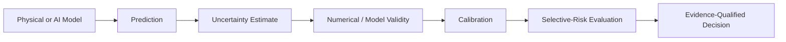
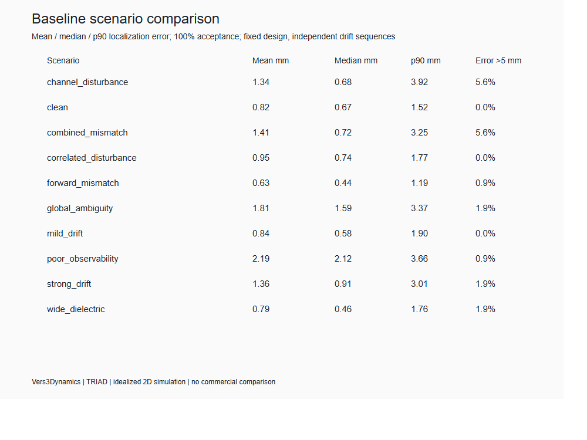
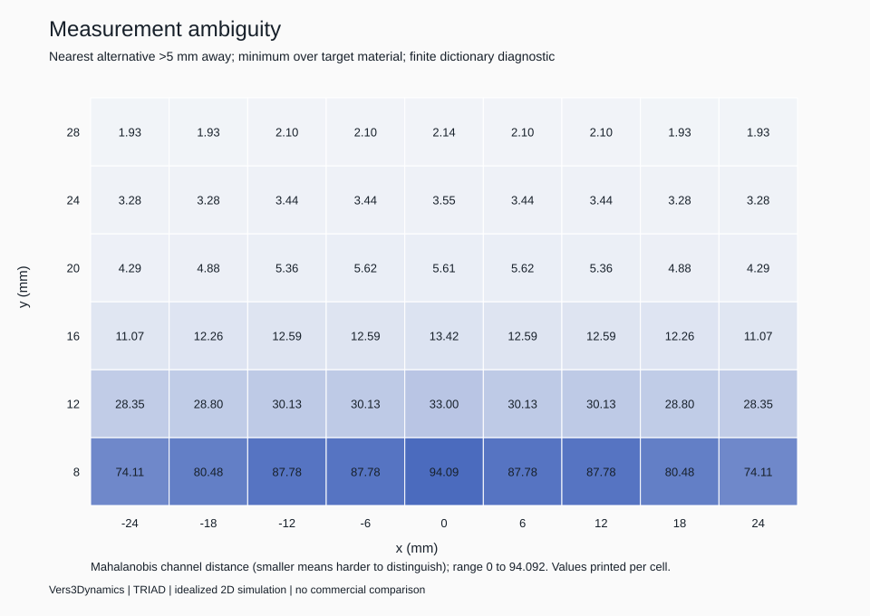
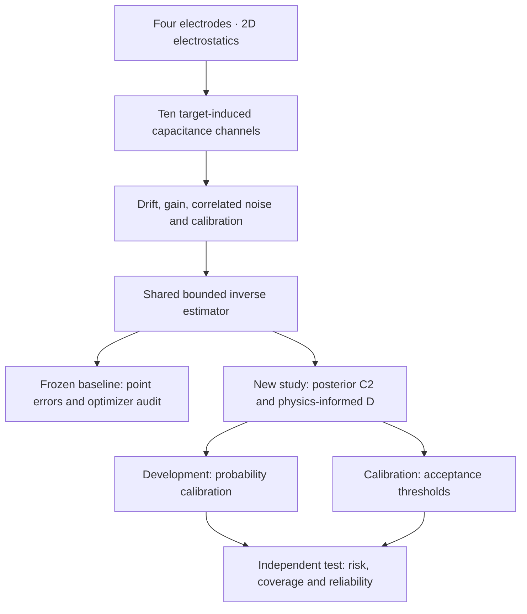

# TRIAD

**When should a sensor refuse to answer?**

Milestone 5 extends the question: **When should any predictive system refuse to
answer because the evidence is insufficient?** The new generic evaluator measures
selective error risk, calibration and distribution-shift behavior while reporting
numerical and statistical limitations separately. This is engineering progress;
physical confidence and a confirmatory C2/D advantage remain unvalidated.



Implemented: JSON evaluation, calibration-fixed thresholds, retrospective ranking,
risk/coverage curves, ECE/Brier diagnostics, whole-cluster bootstrap, explicit
validity reports, a trained logistic demo and bounded measurement-only refinement.
The refinement candidate still abstains; sampling candidate regions does not prove
physical adequacy.

**NIST preparation:** a mechanically checkable [AI Metrology Center methodology draft](docs/metrology/nist-submission-draft.yml) and [readiness checklist](docs/metrology/nist-readiness.md) are included. These are **not** a NIST submission or proof of scientific validity. Run `python scripts/validate-nist-draft.py` after installing the documented Python dependencies. See [Milestone 5 results](docs/metrology/experimental-results.md),
[method definition](docs/metrology/method-definition.md),
[reproduction](docs/metrology/reproducibility.md), and
[NIST draft limitations](docs/metrology/nist-readiness.md).

```sh
cargo run --release --locked -- metrology --help
cargo run --release --locked -- metrology evaluate --input examples/predictions.json --output results/my-evaluation.json
cargo run --release --locked -- metrology validate --input results/my-evaluation.json
cargo run --release --locked -- metrology demo --output results/my-demo
```

Existing output paths are never overwritten. The original Milestones 2–4 evidence
and negative findings remain visible below and are protected by SHA-256 tests.

**When Physics-Informed Confidence Fails: Numerical Model Error in Sparse Capacitive Localization**

[](https://github.com/topherchris420/triad/actions/workflows/ci.yml)
[](LICENSE)

[Portable research components](docs/portable-adoption.md) · [Start here](#start-with-the-evidence) · [Milestone 3 findings](docs/milestone3-results-2026-10-11.md) · [Milestone 4 findings](docs/milestone4-development-results-2026-10-11.md) · [Milestone 4 plan](docs/milestone4-plan.md) · [Original baseline](#baseline-results-the-system-is-accurate-in-some-places-and-fragile-in-others) · [Research code](#new-research-code-test-before-claiming) · [Evidence map](#evidence-map)

*An independent Vers3Dynamics research instrument for sparse capacitive localization, physical observability, and the limits of confident inference.*


> A precise measurement is not necessarily a trustworthy conclusion.

Capacitive sensors register the world through changes in an electric field. Four electrodes might yield ten distinct self/mutual capacitance measurements, yet multiple positions, dielectric properties, and environmental conditions can still explain what was observed. TRIAD asks what happens when a localization algorithm still reports one answer.

The research is deliberately staged. First model the field. Then invert the measurements. Then, only when those foundations withstand numerical and statistical checks, investigate whether physics-informed uncertainty can identify the moments when the evidence is insufficient.

**No hardware performance, commercial superiority, or original selective-prediction method is claimed.**

<p align="center">
  
</p>

*Engineering illustration, not a 3D simulation or computed electric-field visualization. The archived pilot result is shown as context; see the independently recorded Milestone 3 findings below.*



*Plot generated from the frozen conventional-estimator simulation. These are localization errors, not improvements from selective prediction.*

### Milestone 4: numerical diagnosis reveals two distinct problems

A separate ten-probe, development-only study split coarse dictionary interpolation error from direct FEM mesh discrepancy. An exploratory local interpolation stencil reduced **the maximum interpolation-only discrepancy from 29.86 to 2.28 covariance-whitened noise units** (about 92% on these probes). But direct 1 mm-versus-0.5 mm mesh differences still reached **9.82 noise units**, and candidate total-model mismatch reached **10.48**. **Numerical readiness remains false**; the candidate does not yet operate at inference time. Read the [executed diagnostic](docs/milestone4-development-results-2026-10-11.md), the [recorded output](results/numerical-components-v4.json), and the [next research plan](docs/milestone4-plan.md).

### Milestone 3: the experiment has been run

**First executable study completed October 11, 2026. Scientific hypothesis not supported.** The six-probe numerical audit **failed** its readiness gate (worst interpolated-surrogate discrepancy **37.78 covariance-whitened noise units**). At matched 80% acceptance on 3,600 simulated test observations, the physics-informed selector D accepted **37** errors above 5 mm versus **42** for posterior C2, a **0.174-percentage-point** exploratory risk reduction. This did **not** reach the preregistered **2-percentage-point** practical threshold. In geometry screening, the development-selected layout did **not** beat the original on the independent holdout metric.

Read the [complete results and limitations](docs/milestone3-results-2026-10-11.md). The [numerical](results/numerical-audit-v3.json), [selective](results/selective-v3/summary.json), and [geometry](results/geometry-screen-v1.json) reports are committed with provenance. **Passing CI or a successful experimental command is not proof that the physical or statistical hypothesis holds.**

## Portable components: a path from diagnosis to reuse

TRIAD now includes two **engineering-stage**, model-independent interfaces to make the scientific work more reusable without overstating its validity:

| Component | What it does | What it cannot establish |
| :--- | :--- | :--- |
| [Conservative abstention controller](src/abstention.rs) | Fits a fail-closed threshold using fixed candidates and independent labeled calibration sequences; reports simultaneous, sequence-level conditional-risk and coverage bounds | A win for physics-informed D over C2, correctness under unseen distribution shift, or trustworthy scores with a failed forward model |
| [Physical capture inspector](src/capture.rs) | Validates ten-channel recording order, timestamps, units, and empty-reference covariance/drift diagnostics | 3D field physics, commercial sensor equivalence, real-noise validation without actual device data, or permission to feed pF into a pF/m model |

```sh
cargo run --locked -- calibrate-abstention --input examples/abstention-calibration-demo.json
cargo run --locked -- inspect-capture --input examples/synthetic-capture.json
```

Both examples are **synthetic fixtures**. The first intentionally refuses certification from an insufficient calibration sample. This work does **not** rerun or fix the failed Milestone 3/Milestone 4 physics gate. It makes future experiments and real captures auditable, with a documented [hardware/3D validation roadmap](docs/portable-adoption.md).

## Start with the evidence

TRIAD is a **Rust research instrument**, with a frozen simulation baseline and an archived first selective-prediction study that did not pass its numerical readiness or declared primary hypothesis gates. The useful result so far is a distinction: **an optimizer's stopping flag is not a measure of whether its answer is trustworthy**.

```sh
git clone https://github.com/topherchris420/triad.git
cd triad
git switch master
cargo test --locked
cargo run --locked -- --help
cargo run --locked -- audit
```

The audit reads committed predictions and writes a derived report; no expensive FEM experiment is needed to inspect the baseline. Start with [research status](docs/research-status.md) for findings, [the physical model](docs/physical-model.md) for assumptions, or [the selective protocol](docs/selective-v3.md) to work on the next experiment.

A built binary also accepts `--root /path/to/triad` so you can explicitly select a separate repository/data copy. Full baseline commands replace baseline outputs; preserve the committed evidence before running them.

## The question, in equations

The current experiment solves an idealized **2D electrostatic cross-section**:

$$
\nabla\cdot\left(\varepsilon(\mathbf{r})\,\nabla\phi(\mathbf{r})\right)=0.
$$

Four boundary electrodes are excited in turn; reaction charges and energy integrals construct a Maxwell capacitance matrix. Ten unique entries form the measured vector, expressed in **pF/m** (capacitance per unit length), with a target-induced signal formed by subtracting a same-mesh empty reference.

The simulated observation process introduces unknown dielectric properties, correlated noise, and time-varying drift:

$$
\mathbf{z}_t =
\mathrm{diag}\!\left(\mathbf{1}+\mathbf{g}_t\right)
\,\mathbf{f}(x_t,y_t,\varepsilon_{r,t})
+\mathbf{b}+\mathbf{d}_t+a_t\mathbf{1}+\boldsymbol{\eta}_t.
$$

The implemented estimator minimizes a noise-normalized residual over **position and unknown relative permittivity**. It always returns a point, even when an optimizer stopping condition is not met.

The selective experiment has now been **executed once but has not passed scientific validation**. It asks whether a position should be accepted when uncertainty and physics-based observability indicate that it may be wrong. Its principal future comparison is against *posterior expected-error rejection*, not merely an always-answer baseline:

$$
R(\tau)=
\mathbb{P}\!\left(
\left\lVert\hat{\mathbf{x}}-\mathbf{x}\right\rVert>5\,\mathrm{mm}
\,\middle|\,s(\mathbf{z})\geq\tau
\right).
$$

$$
C(\tau)=\mathbb{P}\!\left(s(\mathbf{z})\geq\tau\right).
$$

A reduction in risk caused merely by refusing more predictions is not a discovery. The proposed primary comparison holds **acceptance coverage at 80%** and separates retrospective ranking from a deployable threshold calibrated without test labels.

## What exists today

| Research layer | Implementation | Evidential status |
| :--- | :--- | :--- |
| Industrial reference review | Infineon CAPSENSE source/contract audit | **Documented**, not copied or benchmarked |
| Reverse-engineering instrumentation | REA MCP capability audit | **Connected**, no commercial binary analyzed |
| Forward physics | Four electrodes, dielectric target, P1 FEM, capacitance matrix | **Implemented**, passes frozen numerical gates |
| Simulated observations | Unknown material, baseline calibration, correlated noise and drift | **Implemented**, synthetic only |
| Inverse estimation | Bounded multistart generalized least squares over x, y, and permittivity | **Implemented**, convergence limitations recorded |
| Ambiguity diagnostics | Finite dictionary alternative search and position sensitivity | **Implemented**, not global identifiability proof |
| Nuisance-adjusted local information | Noise-whitened position Jacobian, dielectric Schur complement | **Implemented as a diagnostic**, not an abstention rule |
| Frozen evidence | Saved datasets, predictions, metrics, plots, protocol amendments | **Recorded** and reproducible on the tested host |
| Retrospective optimizer audit | Dedicated read-only analytical command | **Implemented**, generated report is exploratory |
| Posterior C2 / physics-informed D / probability calibration | Versioned Rust study | **Executed and archived; numerical gate failed, primary hypothesis not supported** |
| Electrode geometry screening | Equal-width four-electrode alternatives with independent holdout | **Executed; selected alternative underperformed original on holdout screening metric** |
| Portable abstention policy and capture interchange | Fail-closed model-agnostic gating, strict input/units and covariance diagnostics | **Implemented as engineering infrastructure; not independently validated** |
| 3D fields, fabricated sensors, hardware trials | Outside the current study | **Not performed** |

### Baseline results: the system is accurate in some places and fragile in others

The locked pilot contains **2,520 synthetic observations** across **210 independent sequences**; **1,080** observations belong to the test split. There are ten scenario families, nine test sequences per family, and 12 frames per sequence. These figures come from the committed baseline artifacts, not from a commercial chip.

| Test scenario | Mean localization error | 90th percentile | Error above 5 mm |
| :--- | ---: | ---: | ---: |
| Clean | 0.817 mm | 1.525 mm | 0/108 |
| Strong unseen drift | 1.360 mm | 3.010 mm | 2/108 |
| Drift + material mismatch | 1.407 mm | 3.254 mm | 6/108 |
| Low sensitivity | 2.192 mm | 3.659 mm | 1/108 |
| Near-ambiguous states | 1.813 mm | 3.370 mm | 2/108 |
| Disturbed individual channel | 1.335 mm | 3.916 mm | 6/108 |

Other test scenarios and sequence-level intervals appear in [the recorded research report](docs/research-status.md). The localization problem becomes harder under some shifts, but the current 5 mm error event is **rare**, especially in the designated strong-drift scenario. A later experiment must account for that low event rate before making selective-risk claims.



*Finite-dictionary near-collisions, not a proof of globally indistinguishable physical targets.*

### A finding worth taking seriously

The frozen pilot contains **451 nonconvergence flags among 1,080 returned positions**. Only **10 of the 20 errors above 5 mm** are flagged; the other ten have a successful convergence flag.

That distinction is crucial: **optimizer convergence is not measurement confidence**. An excellent optimization status can accompany an incorrect physical interpretation. Conversely, a flagged optimizer can return an accurate position.

Run the new retrospective audit against the *unchanged* saved evaluation file:

```sh
cargo run --locked -- audit
```

It writes `results/optimizer-audit.json` and records the evaluated source-file hash. It does **not** modify the frozen baseline, calibrate an abstention score, or substantiate the primary hypothesis. See [the optimizer-audit interpretation](docs/optimizer-audit.md).

## How the instrument works



The 2D world consists of four zero-thickness 8 mm electrode strips on the lower boundary of a grounded finite enclosure. A 4 mm radius dielectric disk represents a cylinder extending without end in the omitted direction. The model is *not* a physically complete finite 3D coplanar sensor and does not include substrates, real readout electronics, dispersive losses, or parasitic capacitances.

Implementation: [Fenris](https://crates.io/crates/fenris) for P1 finite-element assembly, [Spade](https://crates.io/crates/spade) for conforming meshes, and [faer](https://crates.io/crates/faer) for sparse linear algebra. Numerical data are produced without Python or a bespoke FEM engine.

### Numerical validation and its limits

Recorded numerical tests include analytical affine/layered-dielectric benchmarks, Maxwell-matrix reciprocity, charge conservation including the enclosing ground, reaction/energy agreement, mesh refinement, target/background equality, and finite-enclosure sensitivity.

**All prescribed gates passed** for the tested probes, but passing relative mesh tolerances does not mean approximation errors are smaller than sensor noise. At one near-electrode probe, the 1 mm-to-0.5 mm mesh signal change was **14.47 times the nominal single-channel noise sigma in Euclidean norm**. The grounded-domain target-induced signal changed by up to **13.23%** at the tested probes when the enclosure was enlarged. Both matter when interpreting likelihoods and confidence.

The [physical-model definition](docs/physical-model.md), [raw validation values](results/validation.json), and [limitations](docs/limitations.md) state exactly what is and is not established.

## Reproduce the locked baseline

Rust and a compatible native linker are required. With a conventional Linux/macOS/Windows Rust environment:

```sh
cargo build --release --locked
cargo test --release --locked
cargo run --release --locked -- validate
cargo run --release --locked -- baseline
cargo run --release --locked -- audit
cargo run --release --locked -- information
```

- `validate`: performs the **numerical physics gates** and records `results/validation.json`.
- `baseline`: generates the locked dataset, fits the conventional estimator, and writes results. Refuses to run without matching validation.
- `audit`: performs a **retrospective descriptive analysis** of the already recorded evaluation, without rerunning estimation.
- `information`: computes a **local Fisher-information diagnostic** with unknown dielectric treated as a nuisance parameter, using saved dictionary-cell midpoints. It does not test a selector or read true test locations.
- `all`: validation, baseline, then optimizer audit. This may be compute-intensive without cached FEM dictionaries.

**Preserve the committed outputs before rerunning**. The pilot already has observed test labels, so any optimizer changes or new hypothesis tests require a **new protocol and fresh untouched test sequences**, not a quiet replacement of the saved evidence.

For the recorded Windows ARM64 environment, an x86-64 GNU Rust toolchain runs under emulation. The project includes a user-local `scripts/build.ps1` helper for that toolchain, if installed:

```powershell
.\scripts\build.ps1 build
.\scripts\build.ps1 test
.\target\release\triad.exe audit
```

The historical Windows log records nine numerical tests. The current suite additionally checks inference, statistical diagnostics, protocol drift, artifact preservation and CLI behavior. GitHub Actions runs the locked suite, checks formatting and recomputes derived audits while checking that frozen baseline files remain unchanged. It does not rerun the full expensive FEM experiment on each commit.

## Independent references, not dependencies

**[Infineon CAPSENSE](https://github.com/Infineon/capsense)** informs the architectural literature review of baseline tracking, thresholds, filtering, and position processing. Its vendor license is restrictive. No CAPSENSE source, firmware, or compiled library is redistributed in TRIAD. The reference work is not a head-to-head performance benchmark.

**[REA: Reverse Engineer Anything](https://github.com/morluto/rea)** is available through MCP for lawful, authorized investigation. TRIAD's audit confirmed an active REA service, **not** a working native decompiler on the recorded Windows ARM64 configuration. No commercial binary was decompiled. The scientific model does not require REA.

References and limits: [commercial source audit](docs/commercial-reference-analysis.md) · [algorithm evidence](docs/algorithm-evidence.md) · [REA capability audit](docs/rea-capability-audit.md) · [prior-art review](docs/literature-review.md).

## New research code: test before claiming

The experimental Milestone 3 code now provides numerical auditing, posterior C2, a preregistered physics-informed D score, probability calibration, drift-only selective risk evaluation, independent sequence-level bootstrap intervals, and exploratory electrode-layout screening. **The first run is now archived.** It did not satisfy the numerical readiness gate or establish the predeclared primary scientific hypothesis; see [recorded results](docs/milestone3-results-2026-10-11.md).

```sh
cargo test --locked
cargo run --release --locked -- numerical
cargo run --release --locked -- selective
cargo run --release --locked -- geometry-screen
```

**The first study ran these commands in order. Do not rerun against the committed repository root:** the archived, versioned output paths now exist and the commands refuse overwrites. Reproducing the same seeds in an isolated copy is a replay, not a new independent scientific test. For scientific revisions, freeze a new protocol, output version, and fresh test seeds. `numerical` quantifies noise-normalized mesh, interpolation, and optimizer error on six development probes. `selective` creates independently seeded development, calibration, and test drift sequences, writes scores before test-truth evaluation, and compares C2 and D at exactly 80% retrospective test acceptance as well as independently calibrated deployment thresholds. It reports Brier/reliability/ECE and paired whole-sequence bootstrap intervals, including null or adverse findings. `geometry-screen` screens five equal-width, four-electrode layouts on an independent development and holdout split; **this is not proof of improved selective risk**.

The old baseline is intentionally never rerun by these commands. Study artifacts use distinct, versioned paths. Every executable protocol setting is checked before running. An existing selective run directory—including an interrupted run—is preserved; numerical and geometry reports also refuse replacement. The selective summary is written last and records hashes of its score, evaluation and run files. Geometry screening checks those hashes before proceeding. See [research integrity and interrupted runs](docs/research-integrity.md). The first study results, including failed scientific gates, are permanently archived and summarized above.

See [the complete Milestone 3 research protocol, limitations and reproducible commands](docs/selective-v3.md), the [versioned machine-readable protocol](experiments/selective-v3.json), and [the original next-experiment gate](docs/next-experiment.md).

## The next experiment: earn the right to abstain

The next stage is **not** to bolt on a confidence percentage. The [Milestone 4 engineering plan](docs/milestone4-plan.md) separates mesh discrepancy from dictionary interpolation, evaluates local refinement as an engineering candidate, and plans a statistically feasible new study without reusing exposed v3 test labels. The development-only command `cargo run --release --locked -- numerical-components` now has an archived result and intentionally refuses replacing it. For a deterministic replay, use a separate checkout with a new output location; an unchanged replay is not new scientific evidence.

 It is to establish a stronger optimization reference, quantify mesh and surrogate-model mismatch in the same units as noise, then pre-register a new powered C2-versus-D comparison. All methods must have the same information budget and independent test sequences.

1. **Audit numerical inference.** Separate projected/boundary stopping conditions from genuinely suboptimal fits; quantify surrogate-interpolation and mesh error.
2. **Test meaningful ambiguity.** Account for unknown dielectric and restricted drift nuisance parameters, as well as near-identical measurements from distant states.
3. **Evaluate strong selectors.** Posterior expected-error rejection (**C2**) and a fixed physics-informed rejection score (**D**) now have experimental code. Residual-only and posterior-variance comparators remain future extensions.
4. **Freeze new tests.** Calibrate thresholds on calibration sequences and evaluate deployment coverage on unseen sequences. Also report matched-coverage risk without pretending it is a deployable threshold.
5. **Accept the null.** If C2 matches or outperforms D, say so. A sophisticated observability score cannot manufacture information absent from the electrodes.

Read [the next-experiment plan](docs/next-experiment.md). The governing [original protocol](docs/experiment-protocol.md) and [documented amendments](docs/protocol-amendments.md) remain intact.

## Evidence map

| For this question | Read |
| :--- | :--- |
| What has actually been measured? | [Research status](docs/research-status.md), [summary JSON](results/summary.json), [scenario comparison](results/plots/scenario-comparison.png) |
| How is electrostatics implemented? | [Physical model](docs/physical-model.md), [forward source](src/forward.rs), [validation JSON](results/validation.json) |
| How are positions estimated? | [Inverse source](src/inverse.rs), [original predictions](results/predictions.json) |
| How are ambiguity and sensitivity assessed? | [Observability source](src/observability.rs), [finite-grid ambiguity](results/ambiguity.json) |
| Can I reproduce it? | [Protocol](docs/experiment-protocol.md), [amendments](docs/protocol-amendments.md), [replay audit](results/reproducibility-check.json) |
| Where could this fail? | [Limitations](docs/limitations.md), [optimizer audit](docs/optimizer-audit.md), [next experiment](docs/next-experiment.md) |
| What is being repaired next? | [Recorded Milestone 4 numerical diagnosis](docs/milestone4-development-results-2026-10-11.md), [numerical and statistical plan](docs/milestone4-plan.md), [exploratory design](experiments/milestone4-design.json) |

The first cached rerun exposed a floating-point JSON round-trip issue; it was corrected without changing scientific parameters. The corrected run reproduced the dataset and localization CSV byte-for-byte on the recorded host. Failure evidence is retained rather than erased.

### Scope, authorship, and reuse

TRIAD is independent research by **Christopher Woodyard, Vers3Dynamics**.

TRIAD is released under the [MIT License](LICENSE). Contributions are welcome; new inference results require reproducible experiments and honest provenance. See [contribution standards](CONTRIBUTING.md). Third-party reference software retains its own licensing terms.

---

**Vers3Dynamics**  
*Resonance as Substrate. Intelligence as a Layer.*

**TRIAD does not begin by asking what the sensor sees. It begins by asking what the measurements permit us to know.**
