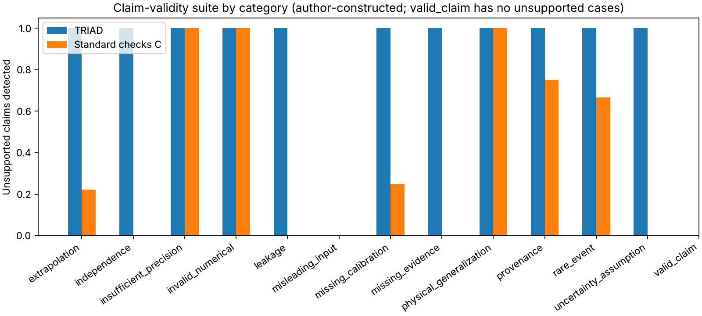

# Milestone 7 results: evidence sufficiency, a second real benchmark, and NIST readiness

**Executed October 11, 2026. Vers3Dynamics, PI Christopher Woodyard.**

**Bottom line.** On a second real dataset, TRIAD's evidence-qualified trust decisions
did **not** improve predictive reliability decisions. They cost slightly more than
standard monitoring at a matched calibration budget, for both models. On an
author-constructed suite of 64 reliability claims, TRIAD's explicit claim-relative
rules flagged far more unsupported claims than standard evidence checks without
rejecting valid ones. Because the same author wrote the rules, the cases and the
ground truth, that result shows engineering detection capability, not general
scientific validity. All four misleading-input cases defeated both methods.

**Evidence insufficient to establish a practical advantage** (Experiment A,
pre-specified decision for both models). Added predictive utility is **not**
established.

## 1. What was frozen, and when

| Commit | Content | Before |
|---|---|---|
| `bb1bd0f` | Research audit, data audit, Experiment A protocol, evidence method, 64-case claim suite with ground truth, Experiment B protocol | any model fit, any 2012 target read, any classifier written |
| `9c63076` | Fitted models, frozen predictions (`manifest.json`), evaluator and evidence engine code | any development, calibration or test metric computed |
| `edc06c6` | Protocol amendment 1 (descriptive outcome-free comparison); fixture tests | any metric computed |
| `5eb8ae9` | Archived results, verifier, figures | — |

This is local, exploratory prespecification in Git, not third-party registration.
After the first suite run, one implementation conformance fix (axiom A5) was made
before archiving. It changed no classification of any case, method or ablation;
the first-run classifications are recorded in
[`results/milestone7-verification.json`](../../results/milestone7-verification.json).
The bike-benchmark numbers were identical before and after that fix.

## 2. Second external benchmark: UCI Bike Sharing (dataset 275)

**Provenance.** Archive `https://archive.ics.uci.edu/static/public/275/bike+sharing+dataset.zip`
(SHA-256 `b70182d0…5401`); `hour.csv` SHA-256 `e03de4ee…504f`; DOI
[10.24432/C5W894](https://doi.org/10.24432/C5W894); CC BY 4.0 per the UCI page;
cite Fanaee-T (2013) and Fanaee-T & Gama (2014). The committed manifest contains
derived hourly fields (date, hour, holiday, workingday, weekday, cnt) with
attribution; the raw archive is retrieved and verified, not committed.

**Audit before fitting** ([data-audit.json](../../benchmarks/bike-sharing/data-audit.json),
2012 targets unread): 17,379 rows; no duplicate timestamps; strictly increasing
time; calendar fields consistent with dates on every row. Timestamps are New York
wall-clock labels: the 02:00 label is absent on both spring-forward days, and each
fall-back day has 24 labels for 25 elapsed hours. On the elapsed-hour axis
165 hours are missing in 75 runs, mostly single night hours (03:00–04:00), plus
five long gaps including 36 hours during Hurricane Sandy (2012-10-29 01:00 to
2012-10-30 12:00). An absent hour may be zero rentals, an outage or a recording gap;
it is never imputed as zero. Discrepancies: UCI metadata lists 17,389 instances
(file and Readme: 17,379); the Readme and the UCI page code `season` differently
(the data match the UCI page). `cnt = casual + registered` holds exactly on all
17,379 rows.

**Task.** One-hour-ahead prediction of `cnt` at elapsed hour T from information
available after hour T−1: the known calendar of T (local hour, workingday, holiday,
weekday, day-of-year) and `log1p cnt` at T−1, T−2, T−3, T−24, T−168 (elapsed
hours, never row adjacency). Excluded: `casual`, `registered`, all observed weather,
`season`, `yr`, `mnth`, `instant`. A target is eligible only if it and all lags
exist.

| Partition (local date of T) | Days | Present hours | Eligible | Missing target hours | Present but a lag missing |
|---|---:|---:|---:|---:|---:|
| Training 2011-01-01…2011-12-31 | 365 | 8,645 | 8,169 | 115 | 476 |
| Development 2012-01-01…04-30 | 121 | 2,894 | 2,849 | 9 | 45 |
| Calibration 2012-05-01…08-31 | 123 | 2,952 | 2,952 | 0 | 0 |
| Test 2012-09-01…12-31 | 122 | 2,888 | 2,806 | 41 | 82 |

**Models** (identical partitions and information; no hyperparameter search):
ridge regression (α = 1, Cholesky; standardised hour × workingday indicators,
holiday, weekday, seasonal terms, lags) and histogram gradient boosting (300
iterations, learning rate 0.05, 31 leaves, minimum leaf 20, seed 71002,
single-threaded), both on `log1p(cnt)`. Per model, an error-scale model was fitted
on development residuals, and a logistic error-probability model on development
material-error indicators. Clean re-preparation was byte-identical on the recorded
host; [`check-bike-reproduction.py`](../../scripts/check-bike-reproduction.py)
checks it with explicit tolerances.

**Material error** (fixed before fitting): |ŷ − y| > max(25, 0.25·y) bikes. It is
an operational convention, not a domain standard. Sensitivity: max(15, 0.15·y) and
max(40, 0.40·y).

## 3. Conventional evaluation (A)

| Test period, 2,806 eligible hours | Ridge | HGB |
|---|---:|---:|
| MAE / RMSE (bikes) | 32.84 / 51.59 | 51.18 / 93.30 |
| Mean bias (bikes) | −16.95 | −33.90 |
| Material-error rate | 9.69% (272) | 21.03% (590) |
| Persistence cnt(T−1) / daily cnt(T−24) / weekly cnt(T−168) MAE | 83.10 / 79.56 / 69.55 | same |
| Calibration-fixed threshold on p | 0.14663 | 0.27253 |
| Selective coverage (target 0.80) | 82.36% | 81.90% |
| Selective risk (accepted errors / accepted) | 9.91% (229/2,311) | 14.88% (342/2,298) |
| AURC (retrospective) | 0.0761 | 0.0950 |
| Event Brier / ECE (10 bins) | 0.0887 / 0.0320 | 0.1503 / 0.0525 |
| Normalised split-conformal 90% coverage | 87.95% (2,468) | 89.99% (2,525) |
| Mean conformal width (bikes) | 129.0 | 192.3 |

Both models beat the naive references. Both under-predict, because 2012 demand
exceeded the 2011 training levels. HGB is markedly worse: tree ensembles cannot
extrapolate beyond the training range (September–October HGB MAE 73.2 and 67.8,
bias −56.7 and −47.9). Conformal coverage is not stable over time: ridge ranges
from 85.8% (October) to 90.1% (September); HGB rises from 82.8% (September) to 96.7%
(December) because its calibration-period (summer) error scale does not transfer to
autumn. Exchangeability between summer calibration and autumn test was never
assumed; these numbers measure what happens without it. Holiday hours had the
highest ridge material-error rate (19.0% of 116 hours versus 9.0% on working days).

## 4. Experiment A: prospective day-level trust decisions

At 00:00 on each test day every policy decides, using only data through the previous
day and the known calendar, whether to withhold that day's otherwise-accepted
predictions. Labels arrive one hour after each target, so the previous day's
outcomes are legitimately available. A degraded day has accepted risk above
r_cal + 0.05 (ridge r_cal 7.96%, HGB 15.71%); days with fewer than five accepted
predictions are unknown. Cost per eligible hour: 1 for an accepted material error,
c for any withheld prediction; primary c = 0.25.

TRIAD's day decision comes from the generic evidence engine: an `operational_risk`
claim per day, with R1 calibration support for the day type (holidays: only 2
calibration days, below the minimum of 5), R2 previous-day KS statistic within the
calibration maximum, R3 at least 22 eligible hours the previous day, and R4 a
design-effect-adjusted Clopper–Pearson contradiction test (calibration lag-1
autocorrelation of the error indicator 0.205 ridge and 0.258 HGB; design effects
1.51 and 1.70).

### Primary endpoint (confirmatory family of two)

| Model | Δ cost, TRIAD − std (matched calibration budget) | 97.5% interval, 7-day blocks | 1-day blocks | 14-day blocks | Identical decision days | Decision |
|---|---:|---|---|---|---:|---|
| Ridge | **+0.00490** | [+0.00059, +0.01052] | [−0.00357, +0.01433] | [+0.00062, +0.01025] | 114/122 | Evidence insufficient to establish a practical advantage |
| HGB | **+0.00624** | [+0.00142, +0.01224] | [+0.00152, +0.01239] | [+0.00124, +0.01309] | 113/122 | Evidence insufficient to establish a practical advantage |

A positive Δ means TRIAD was **worse**. With 7-day blocks, both Bonferroni-adjusted
intervals exclude zero on the adverse side, but both point estimates are below the
pre-specified practical threshold (0.01). By the frozen rule, neither an advantage
nor a practical disadvantage is established. The interval half-widths (about 0.005)
were small enough to detect the pre-specified 0.01 advantage had it existed.

### Policies on the test period (ridge; HGB in `report.json`)

| Policy | Test alert days (calibration) | Degraded days caught / 33 | False alarms / 86 | Episodes caught / 24 | Gated coverage | Gated risk | Per-hour tightening, same coverage | Cost c = 0.10 / 0.25 / 0.50 |
|---|---:|---:|---:|---:|---:|---:|---:|---|
| None | 0 (0) | 0 | 0 | 0 | 82.36% | 9.91% | 9.91% | 0.0993 / **0.1257** / **0.1698** |
| TRIAD | 23 (3) | 7 | 14 | 6 | 68.14% | 9.26% | 10.41% | 0.0949 / 0.1427 / 0.2224 |
| std, matched | 15 (3) | 4 | 9 | 3 | 73.66% | 9.77% | 10.11% | 0.0983 / 0.1378 / 0.2037 |
| cov, matched | 13 (3) | 4 | 8 | 4 | 73.20% | 9.25% | 10.18% | 0.0945 / 0.1347 / 0.2017 |
| perf, matched | 4 (3) | 1 | 3 | 1 | 79.47% | 9.87% | 10.00% | 0.0989 / 0.1297 / 0.1810 |
| std, native 80th percentile | 38 (25) | 11 | 24 | 7 | 57.77% | 8.76% | 10.12% | **0.0928** / 0.1562 / 0.2618 |
| cov, native | 24 (25) | 8 | 15 | 7 | 65.29% | 8.90% | 10.37% | **0.0928** / 0.1449 / 0.2316 |

Findings:

1. **No day-level gate beat "no gate" at the primary abstention cost** (c = 0.25),
   for either model. TRIAD − none = +0.0170 [+0.0075, +0.0290] (ridge) and +0.0139
   [+0.0044, +0.0271] (HGB). Withholding only pays when abstention is cheap: at
   c = 0.10, TRIAD − none = −0.0043 [−0.0110, +0.0019] (ridge) and −0.0054
   [−0.0104, −0.0008] (HGB), but there TRIAD did not beat the native covariate
   monitor (ridge +0.0021 [−0.0032, +0.0078]; HGB +0.0077 [+0.0002, +0.0158]).
2. **TRIAD's flagged days were somewhat riskier for ridge, not for HGB.** Withheld
   accepted predictions had a material-error rate of 13.0% versus 9.3% on retained
   days (ridge), and 14.2% versus 15.0% (HGB). The evidence classification carried
   some information for one model, but not enough to repay withholding at c = 0.25.
3. **Budget inflation under seasonal change.** TRIAD alerted on 3 (ridge) and 2 (HGB)
   calibration days but 23 and 21 test days. R2 fired on 14 test days (autumn
   demand left the summer support), R3 on 10 (gaps including Sandy), R1 on the 5
   holidays, and R4 on 4 ridge days and no HGB days. Comparators matched on
   calibration therefore alerted less in test. At equal *test* alert counts
   (label-free top-k ranking, descriptive), TRIAD was operationally indistinguishable
   from standard monitoring: Δ = −0.0025 [−0.0108, +0.0061] (ridge), +0.0004
   [−0.0063, +0.0065] (HGB); 7 versus 6 caught degraded days.
4. **Detection was poor for every policy.** The best recall was 33% (ridge) and 41%
   (HGB), both from the native `std` policy at false-alarm rates of 28% and 24%.
   Degraded days (33 and 27 of 119 known) form 24 and 18 short episodes. These are
   dependent days, so no independent-trial interval is given.
5. **No early warning of an extreme event.** No policy warned before Hurricane Sandy
   (no weather inputs by design); TRIAD and `std` both withheld 30 October to
   1 November because the previous day's data were incomplete.
6. **Gating versus tightening the hourly threshold.** At the same test coverage,
   ridge day gates had lower accepted risk than tightening the per-hour threshold
   (TRIAD 9.26% vs 10.41%); for HGB the reverse held (15.02% vs 13.78%).
   This is retrospective and descriptive.
7. **Ablations** (TRIAD − ablated TRIAD, c = 0.25, ridge): removing R2 lowers cost by
   0.0045, R1 by 0.0029, R3 by 0.0025, R4 by 0.0025. For HGB, R4 never fired. Every
   rule added cost at the primary abstention cost.
8. **Outcome-free comparison** (protocol amendment 1, descriptive): TRIAD without R4
   versus covariate monitoring at the same calibration budget: +0.0066
   [+0.0023, +0.0117] (ridge), +0.0057 [+0.0020, +0.0102] (HGB).
9. **Agreement.** TRIAD and matched `std` decided identically on 93.4% (ridge,
   κ = 0.75) and 92.6% (HGB, κ = 0.69) of test days, below the pre-specified 95%
   operational-equivalence level.

### Sensitivity

| Tolerance | Ridge material-error rate | Ridge primary Δ [97.5%] | Decision | HGB primary Δ [97.5%] | Decision |
|---|---:|---|---|---|---|
| max(15, 0.15y) | 29.65% | +0.0034 [−0.0005, +0.0081] | insufficient | −0.0024 [−0.0085, +0.0036] | insufficient |
| **max(25, 0.25y), primary** | 9.69% | +0.0049 [+0.0006, +0.0105] | insufficient | +0.0062 [+0.0014, +0.0122] | insufficient |
| max(40, 0.40y) | 2.35% | **+0.0158 [+0.0039, +0.0321]** | **disadvantage established** | +0.0097 [−0.0069, +0.0313] | insufficient |

Under the strictest tolerance, TRIAD's disadvantage for ridge met the practical
threshold. No tolerance produced an advantage. Block length did not change any
decision; the 1-day interval for ridge included zero.

## 5. Experiment B: claim-validity suite

64 single-claim cases: 13 from earlier TRIAD records with ground truth fixed by
earlier milestones, 47 constructed (many from verified Bike Sharing facts), 4 with
deliberately misleading inputs. Ground truth: 16 supported, 1 not applicable,
47 unsupported (28 insufficient, 19 contradicted).

| Method | Unsupported detected | False rejections | Four-class accuracy | Indeterminate | Audit completeness |
|---|---:|---:|---:|---:|---:|
| **TRIAD** | **43/47 (91.5%)** | 0/16 | 60/64 (Wilson 85.0–97.5%) | 27 | 43/43 |
| Standard checks C | 20/47 (42.6%) | 0/16 | 34/64 (41.1–64.8%) | 8 | 17/20 |
| C + scope rule | 26/47 (55.3%) | 0/16 | 40/64 (50.3–73.3%) | 14 | 23/26 |

Primary difference 0.489 (threshold 0.20), false-rejection condition met:
**criterion met on this suite.** Discordant detection pairs 23 (TRIAD only) versus 0;
the exact McNemar p = 2.4×10⁻⁷ is suite-internal and supports no population claim.
Wilson intervals describe the suite only.

| Source | TRIAD detected | C detected | TRIAD accuracy | C accuracy |
|---|---:|---:|---:|---:|
| Repository records (M2–M6 ground truth) | 10/10 | 8/10 | 13/13 | 11/13 |
| Constructed | 33/33 | 12/33 | 47/47 | 23/47 |
| Misleading input | **0/4** | 0/4 | 0/4 | 0/4 |

- TRIAD's only errors are the four misleading-input cases: a false feature-timing
  table, a dependence diagnostic computed on shuffled rows, counts contradicted by
  an unparsed linked artifact, and consecutive hours mislabelled as independent.
  **TRIAD verifies the consistency of what it is given, not the truth of it.**
- On historical records, C missed the M6 calendar-drift claim (unresolved chronology)
  and the M6 matched-coverage claim. Both are scope or limitation failures.
- Each discordant case is explained by one rule family (dependence 5, scope 4,
  leakage mechanics 4, calibration applicability 2, representativeness 2, and
  one each for authority, integrity, applicability, universality, limitations and
  completeness). Removing any single family lowers detection by at most four cases.
  TRIAD's advantage is the sum of many simple explicit rules. A checklist that
  encoded the same rules would reproduce it, as C+scope partly shows (+6 cases).
- Reviewer effort was not measured. As a proxy, 18 of TRIAD's supported findings
  rely on supplied (unverified) structured data.

**Interpretation.** This is circular by construction: one author defined the
categories' rules, built the cases and assigned the ground truth, all frozen before
implementation. The result shows the implementation conforms to its specification
and that standard checks lack those rules. It does not show that the rules
identify unsupported claims in real-world submissions.

## 6. Statistical design and its limits

- Paired comparisons on common test hours and days. Circular moving-block bootstrap
  over 122 test days with 2,000 replicates, seed 71003, and identical resampled days
  across all comparisons. Blocks of 7 days (primary), 1 and 14. Thresholds and
  models are held fixed, so fitting uncertainty is excluded.
- Bonferroni adjustment over the two confirmatory comparisons; everything else is
  descriptive and fully reported.
- Event counts are reported with every rate; null means undefined, never zero.
- Hours and days are dependent; degraded days are not independent episodes; no
  independent-trial interval is computed for detection rates.
- One city, one 4-month test period, two years of data. Seasonal change is
  observed, but it does not establish concept drift.

## 7. Verification

- Rust: all 76 tests pass, 12 of them new in Milestone 7 (rule-level and adversarial
  evidence tests, temporal fixture replay/tamper and strict rejection, a test that
  test-period counts cannot move any fitted quantity, and the frozen-hash test).
  The archived Milestone 5/6 reports still replay byte-for-byte.
- Independent NumPy/SciPy verifier
  ([`verify-milestone7.py`](../../scripts/verify-milestone7.py)): **3,027 checks
  pass**. Coverage: source-to-manifest equality, DST-aware elapsed hours (zoneinfo),
  partitions, all metrics, conformal, every policy decision and cost, every bootstrap
  interval, every suite classification and ablation, and the CLI example.
- Deterministic replay: `metrology validate` reproduces all three new reports
  exactly. A fresh benchmark run is byte-identical to the archive.
- 102 pre-Milestone-7 artifacts are hash-protected
  ([`frozen-before-v7.json`](../../benchmarks/bike-sharing/frozen-before-v7.json)).
- Reference check: all 39 references resolve with matching titles, except one
  (Kelly & Weaver 2004), which has no DOI or URL and is flagged as not
  machine-verifiable.
- Linux and Windows CI results are those of the pull request's GitHub Actions run.

This is independent **code**, not independent **investigators**. No unrelated
researcher has reproduced these results.

## 8. Figures

*Top: retrospective risk–coverage, error-probability reliability, conformal coverage
by month. Bottom: daily accepted risk with prospective TRIAD and matched-std alerts,
and the primary Δ with 97.5% intervals for each block length (dotted lines mark
±0.01). Days are dependent. [PDF](../../results/milestone7-plots/bike-sharing.pdf)*

*Author-constructed suite; detection by category. [PDF](../../results/milestone7-plots/evidence-suite.pdf)*

## 9. Interpretation against the pre-declared outcomes

- **Outcome A (added utility established): not reached.**
- **Outcome B (limited but distinct utility): only partially supported.** TRIAD made
  claim-validity distinctions that standard checks did not, but only on an
  author-constructed suite. The advantage reduces to explicit rules that a checklist
  could adopt, and it fails against misleading inputs. Distinctness from
  assurance-case practice and checklists such as REFORMS is not established.
- **Outcome C (no established additional utility): holds for predictive reliability**,
  replicating the Milestone 6 negative finding on a second dataset with prospective
  decisions.

The strongest remaining value is **methodological and educational**: an executable,
fail-closed way of writing reliability claims with explicit scope, dependence and
calibration conditions, plus a reproducible, honestly negative benchmark.

## 10. Limitations

One public dataset per milestone. Models are deliberately simple. The tolerance and
abstention cost are conventions. The error-probability models were fitted on winter
and spring development data. Calendar support uses only three day types. KS on five
history features is a narrow covariate monitor, and the design effect is an AR(1)
approximation estimated on calibration data. The claim suite is small, synthetic in
most cases, and author-constructed. There was no user study, no unrelated-team
replication, no hardware validation, and no NIST review. The physics-side numerical
readiness of the original sensor study remains failed.

## 11. Reproduce

See the [reproduction package](milestone7-reproduction.md) and the
[benchmark README](../../benchmarks/bike-sharing/README.md).
